<p align="right"><a href="README.pt-BR.md">🇧🇷 Leia em português</a></p>

<p align="center">
  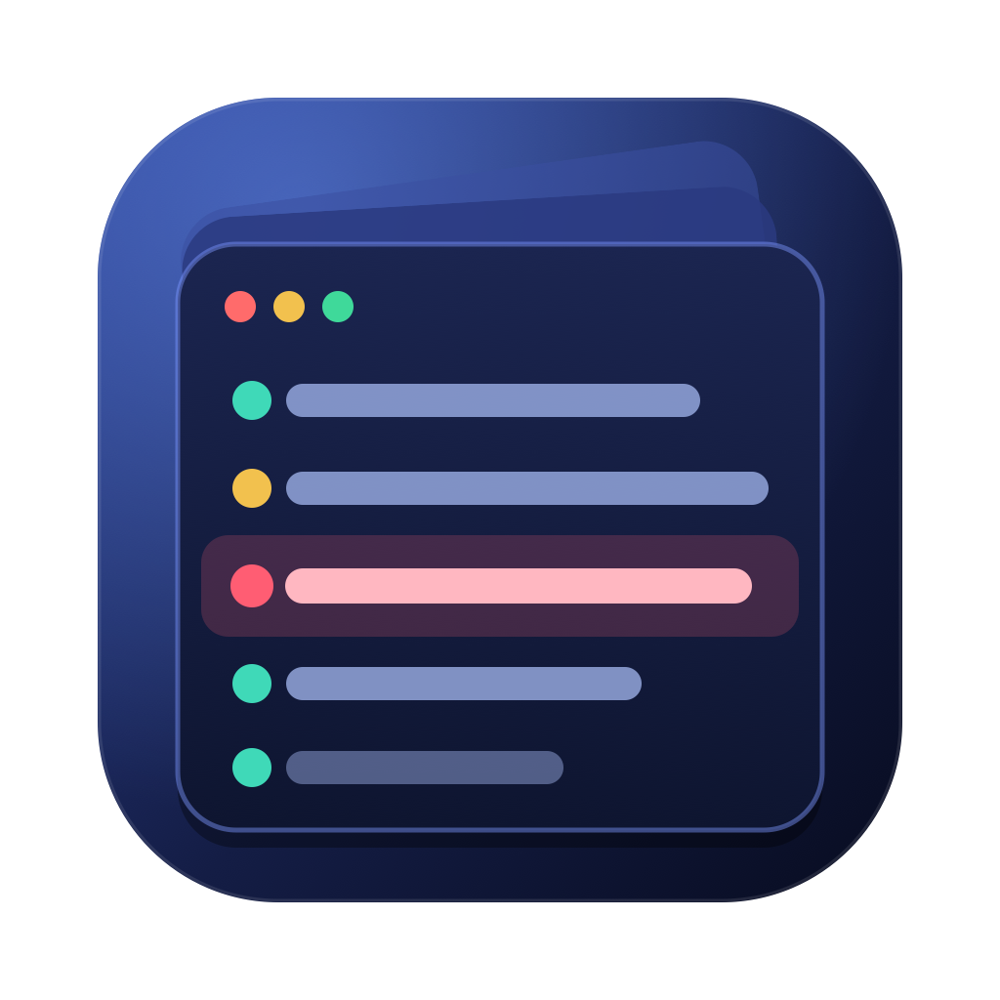
</p>

<h1 align="center">LogDeck</h1>

<p align="center">
  <strong>Kubernetes and OKD logs, no drama.</strong><br>
  A free, open-source log explorer for macOS, Linux and Windows — <strong>read-only</strong>.
</p>

<p align="center">
  <a href="https://github.com/wisecort/LogDeck/releases/latest"></a>
  <a href="LICENSE"></a>
  
  
</p>

<p align="center">
  <code>brew install --cask wisecort/tap/logdeck</code>
  &nbsp;·&nbsp;
  <a href="https://github.com/wisecort/LogDeck/releases/latest">download for macOS, Linux or Windows</a>
</p>

<p align="center">
  <a href="https://apps.microsoft.com/detail/9P5LTZ7FBWC4"></a>
</p>

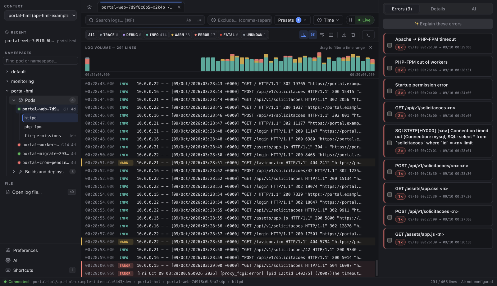

## Why LogDeck

- **Look, don't touch.** kubectl only runs with read verbs (`get`, `logs`, `config get-contexts`, `auth can-i`), and your kubeconfig is never changed.
- **Built to find the problem fast.** Colored levels across many log formats, errors and timeouts grouped with counts, a volume histogram and a side-by-side view of the container that crashed.
- **Built for everyday OKD/OpenShift work.** Build history inside the namespace, readable build logs (steps, push, errors) and build pods kept out of the way.
- **Good-looking and fast.** 50,000 lines without stutter, 9 themes, 4 languages and keyboard shortcuts for everything.

## Tour

### Start wherever you like

The home screen shows the current context, the kubectl version and shortcuts to open pods, log files or the last pod you looked at.

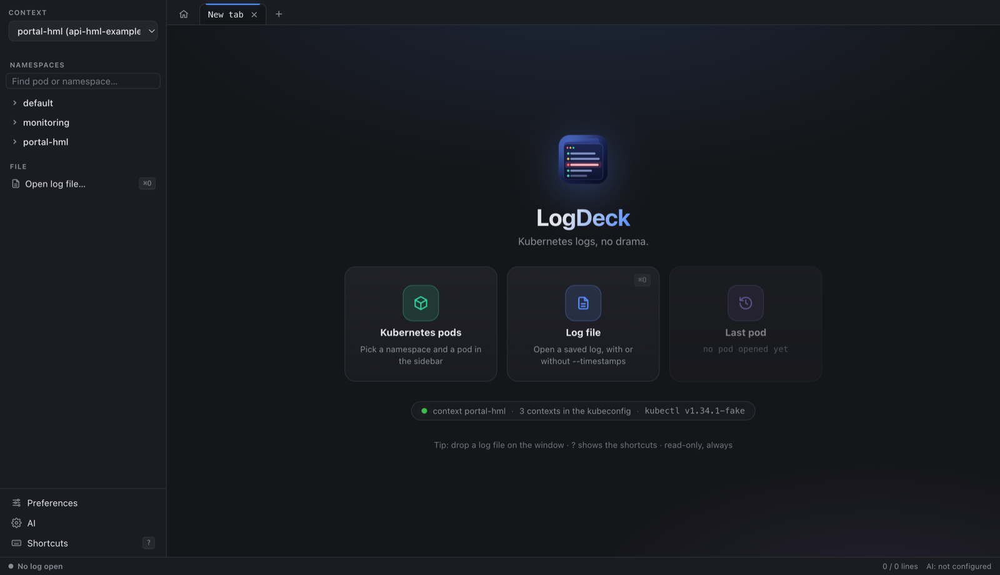

### Details for any line

Click a line to see the log and kubectl timestamps, recognized fields, pretty-printed JSON and the stack trace. **Copy with details** builds a ready-to-paste text with the pod, UTC timestamps, level and the line, with passwords and tokens masked.

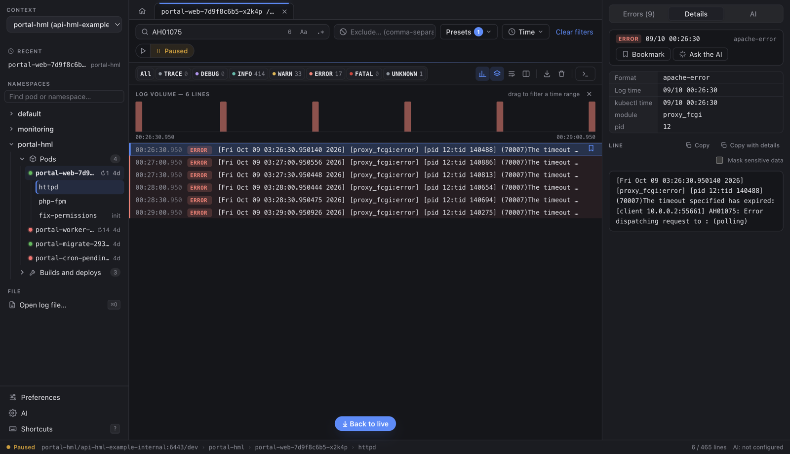

### Grouped errors and timeouts

The **Errors** panel groups repeated errors (Apache → PHP-FPM timeout, `max_children`, database connection, failed build…) with a count and time range. Click a group to filter the log by it; the histogram shows when it happened.

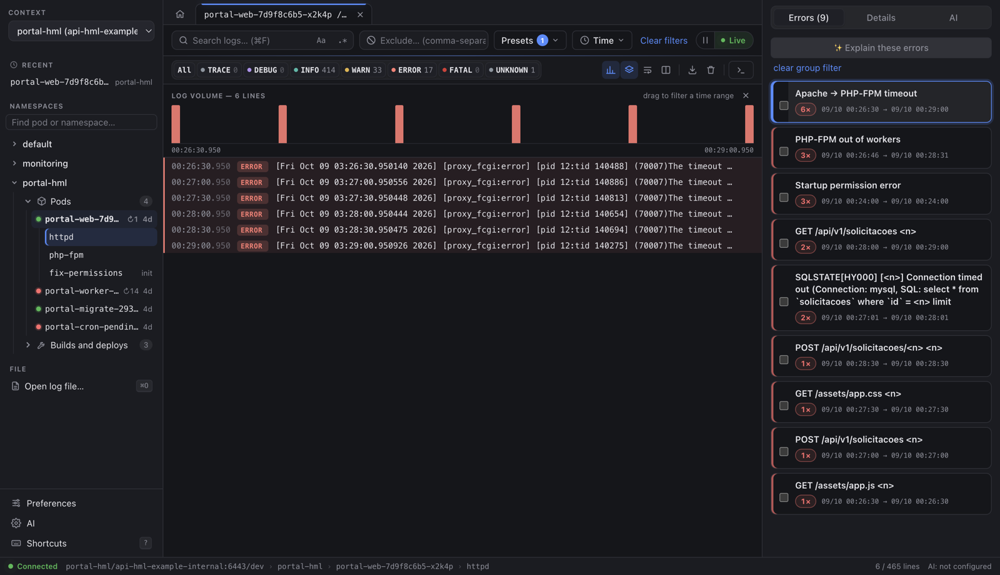

### OKD builds inside the namespace

Each namespace shows a **Pods** folder and a **Builds and deploys** folder with the build history (status, commit, duration). Build logs are understood: `STEP n/m` steps and push as INFO, layers as DEBUG, errors as ERROR, and the panel points out the **Build failed**.

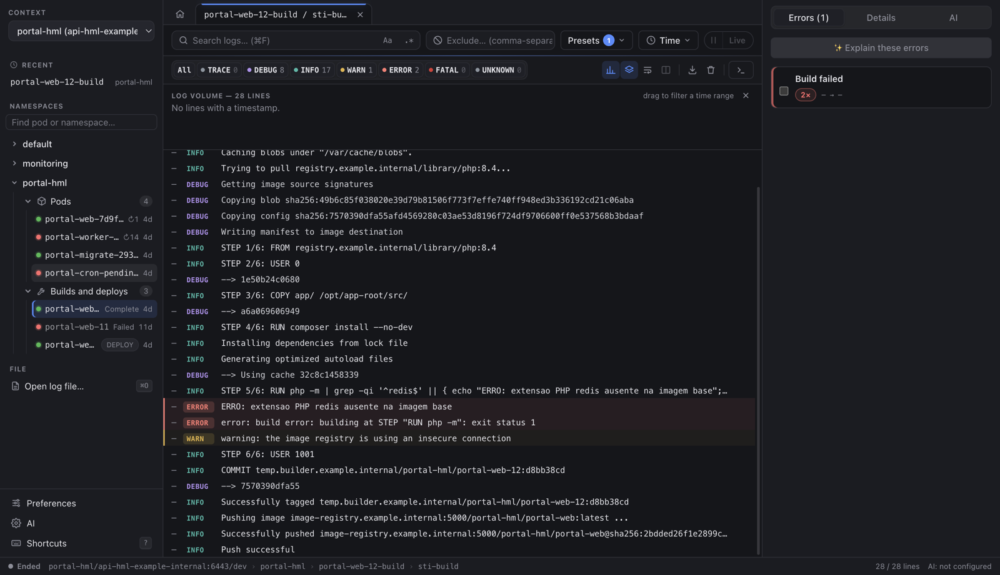

When the cluster has already removed the pod of an old build, LogDeck shows the build details and explains why the log is gone.

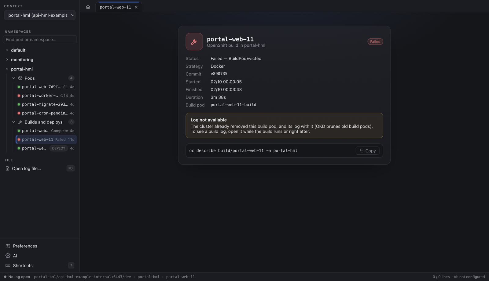

### Why did the pod crash?

On pods with restarts, **Compare with previous** puts the previous container's log (`--previous`) next to the current one, with the same filters. Each pod can live in its own **tab**, receiving logs in the background.

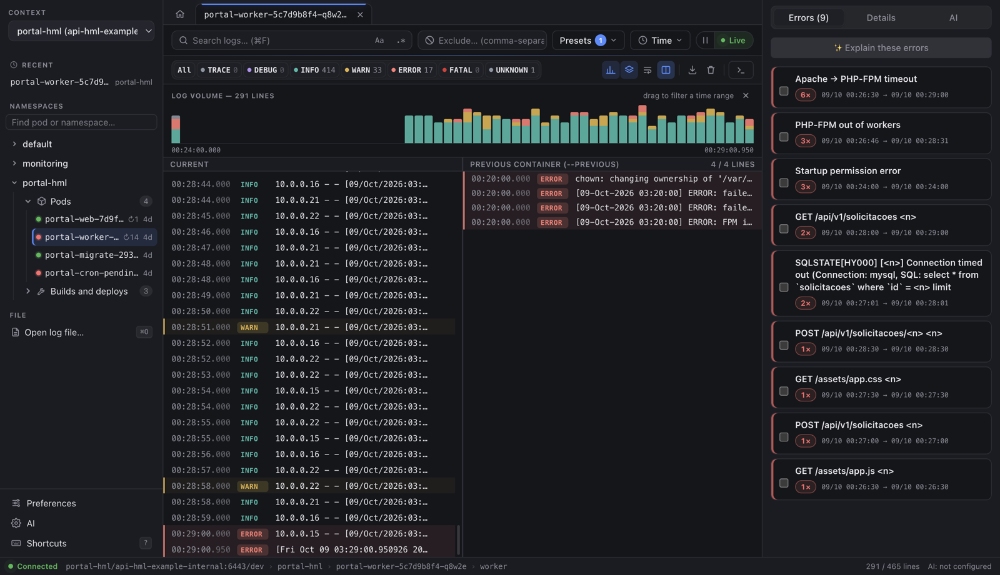

### Your way

Nine themes (Dark, Midnight, Light, System, High contrast, Dracula, Nord, Tokyo Night, Catppuccin), four languages and shortcuts for everything.

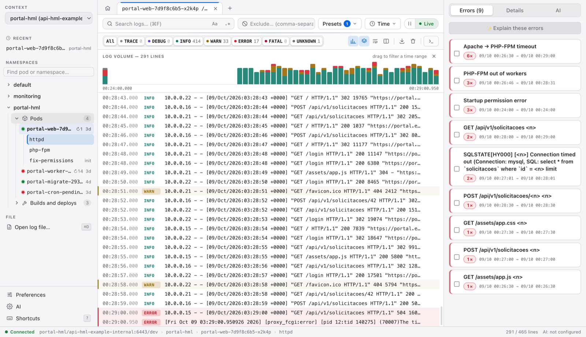

| Preferences | Shortcuts |
|---|---|
| 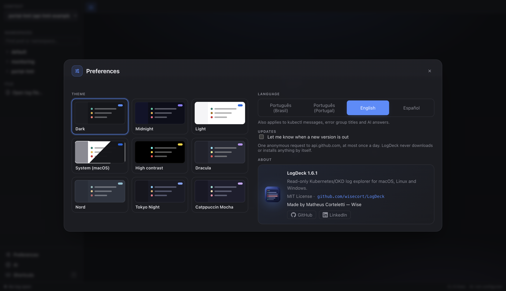 | 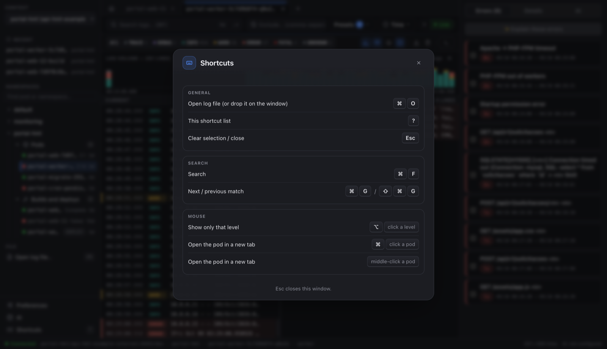 |

## Features

- **Live log** with automatic reconnect; pods that already finished (builds, Jobs) are read once, without reconnecting over and over.
- **Colored levels** (TRACE to FATAL) for JSON, Laravel, Apache, Nginx, PHP-FPM, Java, OKD builds (buildah/docker/s2i) and plain text; stack traces stay with the line they belong to.
- **Search** by text or regex (protected against runaway regexes), **exclusions** and per-namespace presets, such as hiding health checks.
- **Volume histogram**: drag across the bars to see only that time range.
- **Errors and timeouts panel** with counts and time ranges, and **line details** with **Copy with details**.
- **Tabs**, **recent pods** (with × to remove them from the list) and **Compare with previous** (`--previous`).
- **OKD builds**: history, the build container's log and details when the pod is already gone.
- **Terminal in the container**, opened only when you click.
- **Open a saved log file** (⌘O or drag it onto the window).
- **Contexts**: one at a time, with rename and hide inside LogDeck only; EKS and GKE names shortened; production contexts marked **PROD**.
- **Optional AI** to explain errors, with a preview of the masked text and the destination before anything is sent.
- **New-version notice** (opt-in): one anonymous request to GitHub at most once a day, showing the `brew`/`winget` command or the download link. LogDeck never downloads or installs anything by itself.
- **Interface in English, Spanish, Brazilian Portuguese and European Portuguese** (Preferences → Language).

## Installation

### Requirements

- `kubectl` installed:

  | System | Command |
  |---|---|
  | macOS | `brew install kubectl` (the LogDeck Homebrew cask installs it for you) |
  | Linux | `sudo snap install kubectl --classic` or your distribution's `kubectl` package |
  | Windows | `winget install -e --id Kubernetes.kubectl` |

  If kubectl is missing, LogDeck's welcome screen shows this command with a copy button; after installing, click **Check again** (no restart needed).

- A kubeconfig with access to the cluster (the default `~/.kube/config` or the `KUBECONFIG` variable). On OKD/OpenShift, just run `oc login` first. To install `oc`: `brew install openshift-cli` (macOS), `winget install -e --id RedHat.OpenShift-Client` (Windows), or the client from your cluster's console (**?** → **Command line tools**).

### macOS (Apple Silicon or Intel)

**With Homebrew (recommended):**

```bash
brew install --cask wisecort/tap/logdeck
```

The first time, macOS warns that it cannot verify the developer (the app is not notarized by Apple yet). Allow it with:

```bash
xattr -dr com.apple.quarantine /Applications/LogDeck.app
```

or open LogDeck once, dismiss the warning and go to **System Settings → Privacy & Security → Open Anyway**.

| To | Command |
|---|---|
| Update | `brew update && brew upgrade --cask logdeck` |
| See the installed version | `brew info --cask logdeck` |
| Take over a LogDeck already in Applications (installed from the `.dmg`) | `brew install --cask --force wisecort/tap/logdeck` |
| Uninstall | `brew uninstall --cask logdeck` |
| Uninstall everything, including preferences | `brew uninstall --zap --cask logdeck` |

**Manually:** download `LogDeck-<version>-arm64.dmg` (M1 or newer) or `LogDeck-<version>-x64.dmg` (Intel) from the [Releases](https://github.com/wisecort/LogDeck/releases) page, drag LogDeck to **Applications** and allow the first launch as above.

### Linux (x64)

- Debian/Ubuntu: `sudo apt install ./LogDeck-<version>-<arch>.deb`
- Fedora/RHEL: `sudo dnf install ./LogDeck-<version>-<arch>.rpm`
- Any distribution: `chmod +x LogDeck-<version>-<arch>.AppImage` and run the file

To store AI keys, Linux needs a running secret store (GNOME Keyring or KWallet).

### Windows (x64)

**Recommended:** install from the [Microsoft Store](https://apps.microsoft.com/detail/9P5LTZ7FBWC4). The Store package is signed by Microsoft, so there is no SmartScreen warning, and the Store keeps it up to date (it may take a few days to get a new version after the GitHub release).

Or download and run `LogDeck-<version>-<arch>.exe`. It installs for your user only and does not ask for administrator rights. The app is not signed yet: if SmartScreen warns you, click **More info → Run anyway**.

All files are on the [Releases](https://github.com/wisecort/LogDeck/releases) page, with SHA-256 checksums.

## Usage

1. **Pick the context** at the top of the sidebar. It starts on your kubeconfig's current context; **Manage contexts…** lets you rename or hide contexts inside LogDeck only.
2. **Open a namespace** and click a pod (green dot: running; red: in trouble; ↻ = restarts). If the pod has more than one container, pick the container. ⌘-click opens it in a new tab.
3. **Follow the log live.** Scrolling up or clicking a line pauses the view; **Live** jumps back to the end.
4. **Filter:** levels (⌥+click shows only one), search (⌘F, `Aa`, `.*`), exclusions and presets, **Time** (tail, since when, `--previous`) and the histogram.
5. **Investigate:** the **Errors** panel, line **Details**, **Copy with details**, **Compare with previous** and the container **Terminal**.
6. **On OKD:** open the **Builds and deploys** folder and click a build to see its log.
7. **Go back home** with the house icon to the left of the tabs.

### AI (optional)

Set it up under **AI**, at the bottom of the sidebar:

| Provider | Cost | Where the text is processed |
|---|---|---|
| **Claude Code CLI** (`claude`) | no extra cost with a Pro/Max subscription | Anthropic |
| **Anthropic API** | per token (key kept in the system secret store) | Anthropic |
| **OpenAI-compatible API**: Ollama, LM Studio, DeepSeek, OpenRouter, Groq or your own URL | free (local) or the provider's price | on your machine or at the chosen provider |

In the **AI** tab, choose what to send (the selected line with its neighbors, error groups or visible lines), optionally ask a question and click **Prepare to send**. You see the **masked** text (passwords, tokens, e-mails and, if you want, internal IPs) and the **destination** before you click **Send**. Nothing is sent on its own, and commands that would change the cluster are shown struck through and are never run. If the log contains personal or sensitive data, check the privacy rules that apply to you (GDPR, LGPD…) and your organization's policy before using a hosted provider.

## Shortcuts

| Shortcut | Action |
|---|---|
| ⌘O | Open log file |
| ⌘F | Search |
| ⌘G / ⇧⌘G | Next / previous match |
| ⌥ + click on a level | Show only that level |
| ⌘ + click on a pod | Open the pod in a new tab |
| Esc | Clear selection / close |
| ? | Shortcut list |

On Windows and Linux, use Ctrl instead of ⌘, Shift instead of ⇧ and Alt instead of ⌥.

## Security

- **Read-only:** kubectl only runs with `config get-contexts`, `get` (namespaces, pods and OKD builds), `logs`, `auth can-i` and `version --client`. Any other verb is blocked in code. The container terminal only opens when you click.
- **Your kubeconfig stays untouched:** every call uses `--context`; the app never runs `config use-context` and never reads `config view --raw`, tokens or certificates.
- **No shell:** kubectl is called with an argument list, and namespace, pod and container names are validated.
- **AI only on click**, with preview and masking. Logs are treated as data, never as instructions.
- **No telemetry.** The only other connection is the opt-in new-version check (see the [privacy policy](PRIVACY.md)).
- API keys live in the **system secret store** (Keychain on macOS, DPAPI on Windows, GNOME Keyring/KWallet on Linux).

The full rules are in [`GUARDRAILS.md`](GUARDRAILS.md) and the scope in [`SPEC.md`](SPEC.md) (both in Portuguese).

## Troubleshooting

| Symptom | What to do |
|---|---|
| "kubectl not found" | install kubectl (see [Requirements](#requirements)) and reopen LogDeck |
| No contexts show up | check `~/.kube/config` or the `KUBECONFIG` variable; on OKD, run `oc login` |
| "The cluster did not answer within 30 s" | VPN off, network issue or expired login for the context (`oc login`, `aws sso login`…); try `kubectl --context <ctx> get namespaces` |
| Authentication error | the token expired: log in to the cluster again |
| Namespaces are not listed | you lack permission to list them; type the namespace name and press Enter |
| Build without a log | the cluster already removed the build pod; open builds while they run or right after |
| Old lines disappeared | the limit is 50,000 lines; the status bar shows how many were dropped |
| "LogDeck is damaged" (versions up to 1.2.0) | the app is not damaged: the signature was incomplete. Run the `xattr` command from the [installation](#macos-apple-silicon-or-intel) or update |

## Build from source

Requirements: Node 22 or newer (the project uses Node 26, see `.nvmrc`) and build tools (Xcode's on macOS; `build-essential` and `python3` on Linux).

```bash
git clone https://github.com/wisecort/LogDeck.git
cd LogDeck
npm ci
make dev                # run the app in development mode
make harness            # lint, types, guardrails, tests, build, E2E, audit and secrets
npm run release:mac     # macOS: .dmg and .zip (arm64 and x64)
npm run release:linux   # Linux: AppImage, .deb and .rpm
npm run release:win     # Windows: .exe installer
```

Tests never touch a real cluster: they use a fake `kubectl` and fictional logs (so do the screenshots in this README). Contribution rules, including for AI assistants, are in [`AGENTS.md`](AGENTS.md) (in Portuguese).

## Code signing policy

Releases are **not code-signed yet** (except the [Microsoft Store](https://apps.microsoft.com/detail/9P5LTZ7FBWC4) copy, which Microsoft signs): the Windows installer is unsigned (SmartScreen shows a warning; choose "More info → Run anyway"), and the macOS app is ad-hoc signed (not notarized). We plan to reapply to the [SignPath Foundation](https://signpath.org) free signing program once the project has wider adoption. The rules below are the ones signing will follow.

- **What will be signed:** only binaries built from this repository's source by the [release workflow](.github/workflows/release.yml) on GitHub-hosted runners — the `LogDeck.exe` app and the `LogDeck-<version>-x64.exe` installer. Nothing built elsewhere or from third-party sources is signed.
- **Committers and reviewers:** [Matheus Corteletti (@wisecort)](https://github.com/wisecort)
- **Approvers:** [Matheus Corteletti (@wisecort)](https://github.com/wisecort) — every release will be approved by hand before it is signed.
- **Privacy:** this program will not transfer any information to other networked systems unless specifically requested by the user or the person installing or operating it. See the [privacy policy](PRIVACY.md).

## License

[MIT](LICENSE) · Made by Matheus Corteletti — Wise · [GitHub](https://github.com/wisecort/LogDeck) · [LinkedIn](https://www.linkedin.com/in/cortelettimatheus/)
