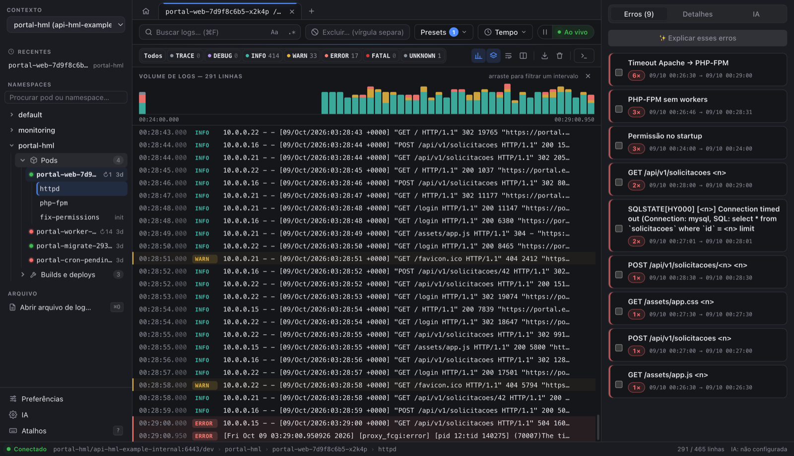
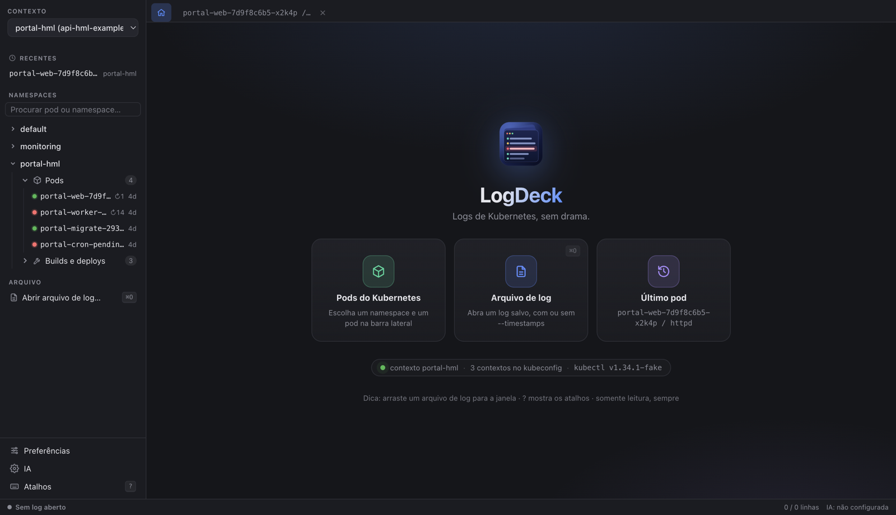
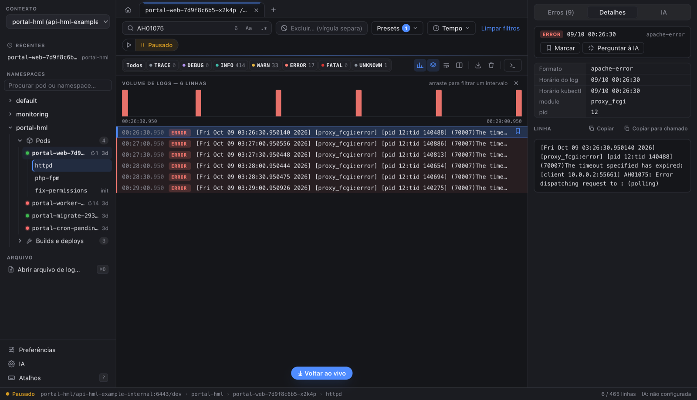
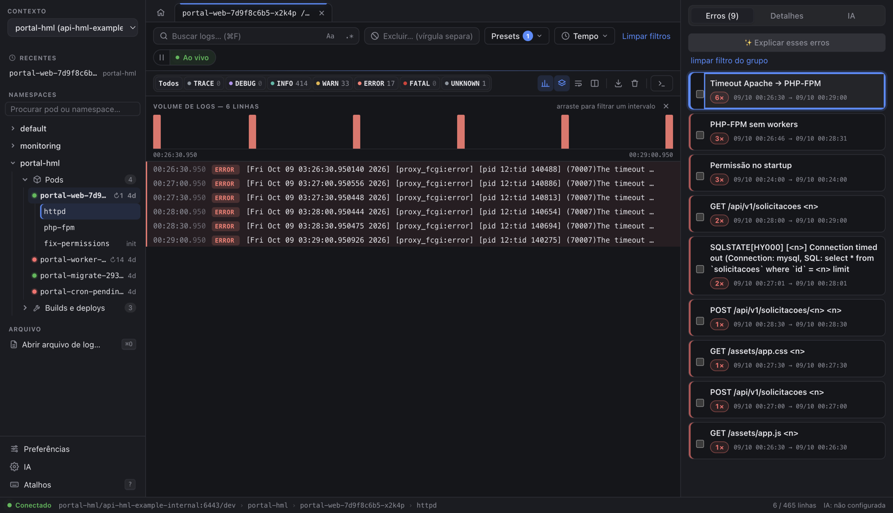
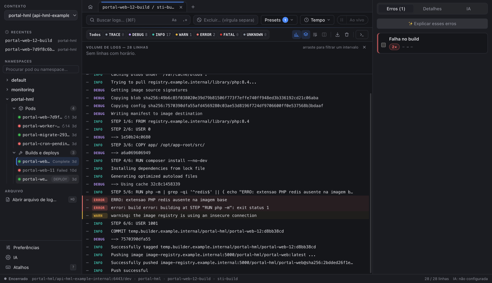
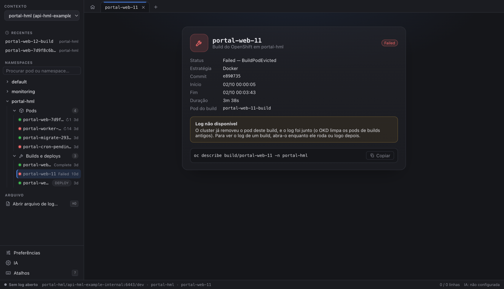
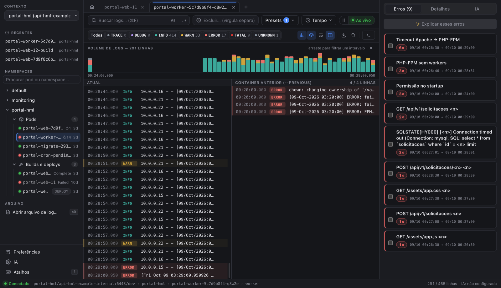
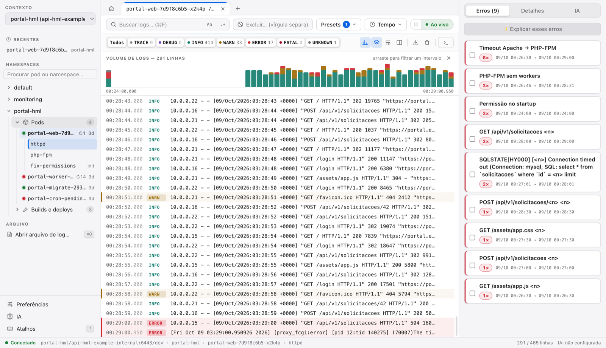
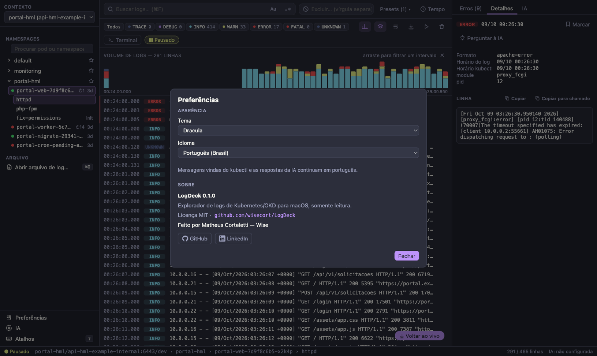
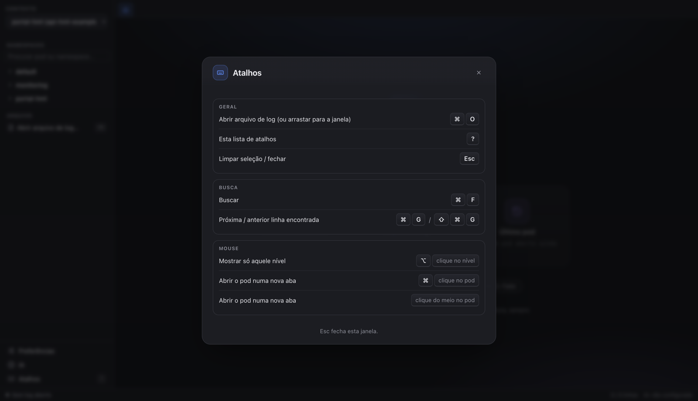

<p align="right"><a href="README.md">🇺🇸 Read in English</a></p>

<p align="center">
  
</p>

<h1 align="center">LogDeck</h1>

<p align="center">
  <strong>Logs de Kubernetes e OKD, sem drama.</strong><br>
  Explorador de logs gratuito e de código aberto para macOS, Linux e Windows — <strong>somente leitura</strong>.
</p>

<p align="center">
  <a href="https://github.com/wisecort/LogDeck/releases/latest"></a>
  <a href="LICENSE"></a>
  
  
</p>

<p align="center">
  <code>brew install --cask wisecort/tap/logdeck</code>
  &nbsp;·&nbsp;
  <a href="https://wisecort.github.io/LogDeck/pt-BR/">site</a>
  &nbsp;·&nbsp;
  <a href="https://github.com/wisecort/LogDeck/releases/latest">baixar para macOS, Linux ou Windows</a>
</p>

<p align="center">
  <a href="https://apps.microsoft.com/detail/9P5LTZ7FBWC4"></a>
</p>



## Por que o LogDeck

- **Olha, não mexe.** O kubectl só roda com verbos de leitura (`get`, `logs`, `config get-contexts`, `auth can-i`), e o seu kubeconfig nunca é alterado.
- **Feito para achar o problema rápido.** Níveis com cores em vários formatos de log, erros e timeouts agrupados com contagem, histograma de volume e comparação com o container que caiu.
- **Feito para o dia a dia no OKD/OpenShift.** Histórico de builds no próprio namespace, log do build legível (passos, push, erros) e pods de build fora do caminho.
- **Bonito e rápido.** 50 mil linhas sem travar, 9 temas, 4 idiomas e atalhos de teclado para tudo.

## Tour

### Comece por onde quiser

A tela inicial mostra o contexto atual, a versão do kubectl e atalhos para abrir pods, arquivos de log ou o último pod que você viu.



### Detalhes de qualquer linha

Clique numa linha para ver os horários do log e do kubectl, os campos reconhecidos, o JSON formatado e o stack trace. **Copiar com detalhes** gera um texto pronto com pod, horários em UTC, nível e a linha, com senhas e tokens mascarados.



### Erros e timeouts agrupados

O painel **Erros** junta os erros repetidos (timeout Apache → PHP-FPM, `max_children`, conexão com banco, falha de build…) com contagem e período. Clique num grupo para filtrar o log por ele; o histograma mostra quando aconteceu.



### Builds do OKD no próprio namespace

Cada namespace mostra a pasta **Pods** e a pasta **Builds e deploys** com o histórico de builds (status, commit, duração). O log do build é reconhecido: passos `STEP n/m` e push em INFO, camadas em DEBUG, erros em ERROR, e o painel aponta a **Falha no build**.



Quando o cluster já removeu o pod de um build antigo, o LogDeck mostra os detalhes do build e explica por que o log não existe mais.



### Por que o pod caiu?

Em pods com restart, **Comparar com o anterior** coloca o log do container anterior (`--previous`) ao lado do atual, com os mesmos filtros. Cada pod pode ficar numa **aba**, recebendo log em segundo plano.



### Do seu jeito

Nove temas (Escuro, Meia-noite, Claro, Sistema, Alto contraste, Dracula, Nord, Tokyo Night, Catppuccin), quatro idiomas e atalhos para tudo.



| Preferências | Atalhos |
|---|---|
|  |  |

## Recursos

- **Log ao vivo** com reconexão automática; pods já terminados (builds, Jobs) são lidos uma vez, sem ficar reconectando.
- **Níveis com cores** (TRACE a FATAL) em JSON, Laravel, Apache, Nginx, PHP-FPM, Java, builds do OKD (buildah/docker/s2i) e texto livre; stack traces ficam juntos da linha de origem.
- **Busca** por texto ou regex (com proteção contra regex que trava), **exclusões** e presets por namespace, como esconder health checks.
- **Histograma de volume**: arraste sobre as barras para ver só aquele intervalo.
- **Painel de erros e timeouts** com contagem e período, e **detalhes da linha** com **Copiar com detalhes**.
- **Abas**, **pods recentes** (com × para tirar da lista) e **Comparar com o anterior** (`--previous`).
- **Builds do OKD**: histórico, log do container do build e detalhes quando o pod já foi removido.
- **Terminal no container**, aberto só quando você clica.
- **Abrir arquivo de log** salvo (⌘O ou arrastando para a janela).
- **Contextos**: um por vez, com renomear e ocultar só no LogDeck; nomes do EKS e do GKE encurtados; contextos de produção marcados com **PROD**.
- **IA opcional** para explicar erros, com preview do texto mascarado e do destino antes de qualquer envio.
- **Aviso de versão nova** (só se você aceitar): uma consulta anônima ao GitHub no máximo uma vez por dia, mostrando o comando do `brew`/`winget` ou o link para baixar. O LogDeck nunca baixa nem instala nada sozinho.

## Instalação

### Requisitos

- `kubectl` instalado:

  | Sistema | Comando |
  |---|---|
  | macOS | `brew install kubectl` (o Homebrew do LogDeck já instala junto) |
  | Linux | `sudo snap install kubectl --classic` ou o pacote `kubectl` da sua distribuição |
  | Windows | `winget install -e --id Kubernetes.kubectl` |

  Se o kubectl não estiver instalado, a tela inicial do LogDeck mostra esse comando com um botão de copiar; depois de instalar, clique em **Verificar de novo** (não precisa reiniciar).

- Um kubeconfig com acesso ao cluster (o padrão `~/.kube/config` ou a variável `KUBECONFIG`). No OKD/OpenShift, basta fazer `oc login` antes. Para instalar o `oc`: `brew install openshift-cli` (macOS), `winget install -e --id RedHat.OpenShift-Client` (Windows) ou o cliente no console do seu cluster (**?** → **Command line tools**).

### macOS (Apple Silicon ou Intel)

**Pelo Homebrew (recomendado):**

```bash
brew install --cask wisecort/tap/logdeck
```

Na primeira vez, o macOS avisa que não consegue verificar o desenvolvedor (o app ainda não é notarizado pela Apple). Libere com:

```bash
xattr -dr com.apple.quarantine /Applications/LogDeck.app
```

ou abra o LogDeck uma vez, feche o aviso e vá em **Ajustes do Sistema → Privacidade e Segurança → Abrir mesmo assim**.

| Para | Comando |
|---|---|
| Atualizar | `brew update && brew upgrade --cask logdeck` |
| Ver a versão instalada | `brew info --cask logdeck` |
| Já tem o LogDeck em Aplicativos (instalado pelo `.dmg`) | `brew install --cask --force wisecort/tap/logdeck` |
| Remover | `brew uninstall --cask logdeck` |
| Remover tudo, inclusive preferências | `brew uninstall --zap --cask logdeck` |

**Manualmente:** baixe `LogDeck-<versão>-arm64.dmg` (M1 ou mais novo) ou `LogDeck-<versão>-x64.dmg` (Intel) na página de [Releases](https://github.com/wisecort/LogDeck/releases), arraste o LogDeck para **Aplicativos** e libere a primeira abertura como acima.

### Linux (x64)

- Debian/Ubuntu: `sudo apt install ./LogDeck-<versão>-<arq>.deb`
- Fedora/RHEL: `sudo dnf install ./LogDeck-<versão>-<arq>.rpm`
- Qualquer distribuição: `chmod +x LogDeck-<versão>-<arq>.AppImage` e abra o arquivo

Para guardar chaves de IA, o Linux precisa de um cofre de senhas ativo (GNOME Keyring ou KWallet).

### Windows (x64)

**Recomendado:** instale pela [Microsoft Store](https://apps.microsoft.com/detail/9P5LTZ7FBWC4). O pacote da Store é assinado pela Microsoft, então o SmartScreen não avisa nada, e a própria Store mantém o app atualizado (uma versão nova pode levar alguns dias para chegar lá depois da release do GitHub).

Ou baixe e rode `LogDeck-<versão>-<arq>.exe`. A instalação é só para o seu usuário e não pede administrador. O app ainda não é assinado: se o SmartScreen avisar, clique em **Mais informações → Executar assim mesmo**.

Todos os arquivos ficam na página de [Releases](https://github.com/wisecort/LogDeck/releases), com os checksums SHA-256.

## Como usar

1. **Escolha o contexto** no topo da barra lateral. Ele começa no contexto atual do seu kubeconfig; em **Gerenciar contextos…** você renomeia ou oculta contextos só no LogDeck.
2. **Abra um namespace** e clique num pod (bolinha verde: rodando; vermelha: com problema; ↻ = restarts). Se o pod tiver mais de um container, escolha o container. ⌘-clique abre numa aba nova.
3. **Acompanhe o log ao vivo.** Rolar para cima ou clicar numa linha pausa a tela; **Ao vivo** volta para o fim.
4. **Filtre:** níveis (⌥+clique mostra só um), busca (⌘F, `Aa`, `.*`), exclusões e presets, **Tempo** (tail, desde quando, `--previous`) e o histograma.
5. **Investigue:** painel **Erros**, **Detalhes** da linha, **Copiar com detalhes**, **Comparar com o anterior** e **Terminal** no container.
6. **No OKD:** abra a pasta **Builds e deploys** e clique num build para ver o log dele.
7. **Volte ao início** pelo ícone de casa, à esquerda das abas.

### IA (opcional)

Configure em **IA**, no rodapé da barra lateral:

| Provedor | Custo | Onde o texto é processado |
|---|---|---|
| **Claude Code CLI** (`claude`) | sem custo extra com assinatura Pro/Max | Anthropic |
| **API da Anthropic** | por token (chave no cofre do sistema) | Anthropic |
| **API compatível com OpenAI**: Ollama, LM Studio, DeepSeek, OpenRouter, Groq ou URL própria | grátis (local) ou do provedor | na sua máquina ou no provedor escolhido |

Na aba **IA**, escolha o que enviar (linha selecionada com as vizinhas, grupos de erro ou linhas visíveis), faça uma pergunta se quiser e clique em **Preparar envio**. Você vê o texto **mascarado** (senhas, tokens, e-mails e, se quiser, IPs internos) e o **destino** antes de **Enviar**. Nada é enviado sozinho, e comandos que alterariam o cluster aparecem riscados e nunca são executados. Se o log tiver dados pessoais ou sensíveis, avalie a LGPD e a política da sua organização antes de usar um provedor hospedado.

## Atalhos

| Atalho | Ação |
|---|---|
| ⌘O | Abrir arquivo de log |
| ⌘F | Buscar |
| ⌘G / ⇧⌘G | Próxima / anterior linha encontrada |
| ⌥ + clique no nível | Mostrar só aquele nível |
| ⌘ + clique no pod | Abrir o pod numa nova aba |
| Esc | Limpar seleção / fechar |
| ? | Lista de atalhos |

No Windows e no Linux, use Ctrl no lugar de ⌘, Shift no lugar de ⇧ e Alt no lugar de ⌥.

## Segurança

- **Só leitura:** o kubectl só roda com `config get-contexts`, `get` (namespaces, pods, eventos, services, ingresses, routes e builds do OKD), `logs`, `auth can-i` e `version --client`. Qualquer outro verbo é bloqueado no código. O terminal no container só abre quando você clica.
- **Seu kubeconfig fica intacto:** cada chamada usa `--context`; o app nunca faz `config use-context` nem lê `config view --raw`, tokens ou certificados.
- **Sem shell:** o kubectl é chamado com uma lista de argumentos, e nomes de namespace, pod e container são validados.
- **IA só com clique**, preview e mascaramento. Os logs são tratados como dados, nunca como instruções.
- **Sem telemetria.** A única outra conexão é o aviso de versão nova, que você precisa aceitar (veja a [política de privacidade](PRIVACY.pt-BR.md)).
- As chaves de API ficam no **cofre do sistema** (Keychain no macOS, DPAPI no Windows, GNOME Keyring/KWallet no Linux).

As regras completas estão em [`GUARDRAILS.md`](GUARDRAILS.md) e o escopo em [`SPEC.md`](SPEC.md).

## Problemas comuns

| Sintoma | O que fazer |
|---|---|
| "kubectl não encontrado" | instale o kubectl (veja [Requisitos](#requisitos)) e abra o LogDeck de novo |
| Nenhum contexto aparece | confira o `~/.kube/config` ou a variável `KUBECONFIG`; no OKD, faça `oc login` |
| "O cluster não respondeu em 30 s" | VPN desligada, rede ou login do contexto vencido (`oc login`, `aws sso login`…); teste com `kubectl --context <ctx> get namespaces` |
| Erro de autenticação | o token expirou: faça login de novo no cluster |
| Não lista namespaces | falta permissão de listar; digite o nome do namespace e tecle Enter |
| Build sem log | o cluster já removeu o pod do build; abra builds enquanto rodam ou logo depois |
| Linhas antigas sumiram | o limite é 50 mil linhas; a barra de status mostra quantas foram descartadas |
| "LogDeck está danificado" (versões até 1.2.0) | o app não está danificado: era a assinatura incompleta. Rode o `xattr` da [instalação](#macos-apple-silicon-ou-intel) ou atualize |

## Construir a partir do código

Requisitos: Node 22 ou mais novo (o projeto usa Node 26, veja `.nvmrc`) e ferramentas de compilação (no macOS, as do Xcode; no Linux, `build-essential` e `python3`).

```bash
git clone https://github.com/wisecort/LogDeck.git
cd LogDeck
npm ci
make dev                # abre o app em modo desenvolvimento
make harness            # lint, tipos, guardrails, testes, build, E2E, auditoria e segredos
npm run release:mac     # macOS: .dmg e .zip (arm64 e x64)
npm run release:linux   # Linux: AppImage, .deb e .rpm
npm run release:win     # Windows: instalador .exe
```

Os testes nunca acessam um cluster de verdade: usam um `kubectl` falso e logs fictícios (as capturas deste README também). Como contribuir está em [`CONTRIBUTING.md`](CONTRIBUTING.md) (em inglês); as regras completas, inclusive para assistentes de IA, estão em [`AGENTS.md`](AGENTS.md). Problemas de segurança: veja [`SECURITY.md`](SECURITY.md).

## Política de assinatura de código

As versões **ainda não têm assinatura de código** (exceto a cópia da [Microsoft Store](https://apps.microsoft.com/detail/9P5LTZ7FBWC4), que a Microsoft assina): o instalador de Windows não é assinado (o SmartScreen mostra um aviso; escolha "Mais informações → Executar assim mesmo"), e o app de macOS tem assinatura ad-hoc (sem notarização). Pretendemos pedir de novo a assinatura grátis da [SignPath Foundation](https://signpath.org) quando o projeto tiver mais uso. As regras abaixo são as que a assinatura vai seguir.

- **O que será assinado:** só binários gerados a partir do código deste repositório pelo [workflow de release](.github/workflows/release.yml), em runners hospedados pelo GitHub: o app `LogDeck.exe` e o instalador `LogDeck-<versão>-x64.exe`. Nada gerado em outro lugar ou a partir de código de terceiros é assinado.
- **Commits e revisão:** [Matheus Corteletti (@wisecort)](https://github.com/wisecort)
- **Aprovação:** [Matheus Corteletti (@wisecort)](https://github.com/wisecort). Cada release será aprovada manualmente antes de ser assinada.
- **Privacidade:** este programa não transfere nenhuma informação para outros sistemas em rede, a não ser quando o usuário, ou quem instala ou opera o programa, pede isso explicitamente. Veja a [política de privacidade](PRIVACY.pt-BR.md).

## Licença

[MIT](LICENSE) · Feito por Matheus Corteletti — Wise · [GitHub](https://github.com/wisecort/LogDeck) · [LinkedIn](https://www.linkedin.com/in/cortelettimatheus/)
